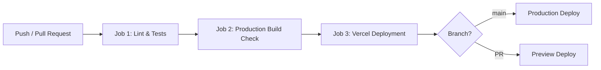

# CI/CD Pipeline & Vercel Deployment Guide 🚀

This repository is equipped with a GitHub Actions CI/CD pipeline defined in [`.github/workflows/ci-cd.yml`](file:///.github/workflows/ci-cd.yml).

---

## ⚡ Pipeline Overview

The pipeline triggers automatically on:
- **`push`** to `main` and `development` branches
- **`pull_request`** targeting `main` and `development` branches
- **`workflow_dispatch`** (Manual run directly from the GitHub Actions tab)

### 3-Stage Gated Architecture:



1. **Stage 1: Lint & Test Suite (`test-and-lint`)**
   - Lints code using `oxlint` (`npm run lint`)
   - Executes unit & data integrity tests via Node native test runner (`npm test`)
   - Tests `VirtualFrappeContext`, Desk UI APIs, custom buttons, quest catalog, and 50 enterprise scenarios.

2. **Stage 2: Production Build Check (`build-check`)**
   - Verifies Vite production bundling (`npm run build`)
   - Catches syntax, import, or asset bundle errors before any deployment
   - Generates and uploads dist build artifacts for 7-day retention.

3. **Stage 3: Vercel Deployment (`deploy-vercel`)**
   - Depends on Stage 1 & 2 passing successfully.
   - **For PRs**: Deploys a Preview deployment.
   - **For `main` branch push**: Deploys to Production (`--prod`).

---

## 🔐 Vercel Integration Options

The pipeline is designed to work with both Vercel connection methods:

### Option A: Direct Vercel GitHub App Integration (Zero Config)
If your repository is linked to Vercel via the Vercel Dashboard (GitHub App integration):
1. Vercel automatically detects pushes and PRs.
2. Under **GitHub Repository Settings ➔ Branches ➔ Branch protection rules** for `main`:
   - Enable **"Require status checks to pass before merging"**.
   - Check `🧪 Lint & Test Suite` and `🏗️ Production Build Check`.
3. Vercel will only deploy code that passes this pipeline!

### Option B: GitHub Actions Vercel CLI Deployment (Full Pipeline Control)
If you want GitHub Actions to deploy directly via the Vercel CLI:
1. In your **Vercel Dashboard**:
   - Go to **Account Settings ➔ Tokens** ➔ Click **Create Token** (name it e.g. `frappe-github-actions`).
   - Copy the token value.
2. In your Project root on your local machine (or in Vercel Project Settings ➔ General):
   - Find your **Project ID** (`projectId`) and **Org ID** (`orgId` / `teamId`).
3. In your **GitHub Repository**:
   - Go to **Settings ➔ Secrets and variables ➔ Actions**.
   - Click **New repository secret** and add:
     - `VERCEL_TOKEN`: Your Vercel token
     - `VERCEL_ORG_ID`: Your Vercel Org/Team ID
     - `VERCEL_PROJECT_ID`: Your Vercel Project ID
4. Once added, the pipeline's `deploy-vercel` job will automatically execute prebuilt production deployments on push to `main` and preview deployments on PRs!

---

## 🧪 Running Tests Locally

```bash
# Run lint check
npm run lint

# Run unit tests
npm test

# Run production build
npm run build
```
